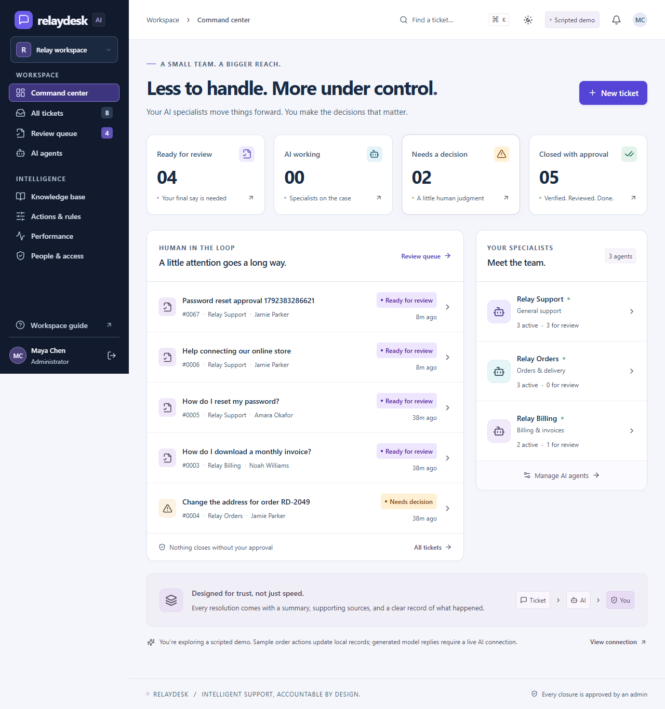

# RelayDesk

**Your AI team. Your final say.**

RelayDesk is a support workspace for a small business with one or two administrators and a team of specialist AI agents. Agents investigate tickets, use approved knowledge and permitted actions, and propose a resolution. A Support reviewer or Admin reviews the evidence and explicitly approves closure. Support approvals require private notes; Admins also manage accounts, agents, knowledge, and recoverable ticket deletion.



## What works

- Customer and administrator accounts with server-side permissions and HTTP-only cookie sessions.
- Three independently configured service identities: Relay Support, Relay Orders, and Relay Billing.
- Specialist assignment, pause controls, instructions, and an editable agent-specific knowledge base.
- Durable, versioned AI jobs with leases, retry limits, cancellation, source references, usage records, and an execution timeline.
- A review queue with approve-and-close and request-more-work actions.
- Stale-review protection and exactly one winner for simultaneous assignment or approval requests.
- Live ticket updates and customer conversations through authenticated Socket.IO connections.
- A sample store action: update an eligible order's shipping address, then verify the saved result.
- First-response deadlines and overdue notifications.
- Performance reports with 7/30/90-day periods, AI mode filters, specialist comparisons, review outcomes, response and closure percentiles, current backlog, and CSV export.
- Responsive Chart.js activity charts with hover details and an accessible daily data table.
- Responsive indigo-and-slate UI with readable typography.

**AI execution modes are explicit.** The no-key demo uses scripted responses; it does not call a language model. The order lookup and address updates still operate on the local sample PostgreSQL records. A live OpenAI Responses adapter is implemented, but live generation was not exercised during development here because no API key was configured.

## Quick local demo

Requirements: Node.js 22.12 or newer and npm.

```sh
npm ci
npm run demo
```

Open **http://localhost:5173**. Use the demo role buttons on the sign-in screen, or these sample accounts:

| Account              | Email                   | Password       |
| -------------------- | ----------------------- | -------------- |
| Administrator        | admin@relaydesk.demo    | RelayDesk!2026 |
| Second administrator | alex@relaydesk.demo     | RelayDesk!2026 |
| Support reviewer     | support@relaydesk.demo  | RelayDesk!2026 |
| Customer             | customer@relaydesk.demo | RelayDesk!2026 |

The demo uses embedded PostgreSQL (PGlite) in `.local/ai-postgres`. Run one demo process at a time. The earlier prototype's sample database is retained separately at `.local/postgres`; the revamped preview starts with its own seeded workspace. Neither original ServeAll repository is modified.

If a root `.env` already sets `AI_MODE=unavailable`, set it to `demo` for this walkthrough. Never run demonstration seeds against a database containing real customer data.

## A two-minute walkthrough

1. Enter the admin workspace and open a ticket in **Review queue**. Inspect its summary, evidence, conversation, and execution log.
2. Choose **Request more work** to send private feedback back to the specialist, or **Approve & close** to record an administrator-approved closure.
3. In a separate browser profile, enter the customer experience and submit a delivery-address question for order `RD-2048`.
4. As an administrator, find the new ticket and assign **Relay Orders**.
5. Reply as the customer with `New address: 42 Willow Avenue, Kuala Lumpur 50480`.
6. See the verified address-change result and the new review proposal. Approve it as the administrator and watch the customer's screen update.
7. Try the same request with shipped order `RD-2049`: the policy prevents the change and the ticket needs an admin decision.

## PostgreSQL server setup

Use this path for the production storage driver and real multi-connection concurrency checks.

```sh
# Copy .env.example to .env using your shell or editor.
docker compose up -d
npm run db:migrate
npm run db:seed    # optional: disposable development sample data only
npm run dev
```

Run `npm run worker` in another terminal for overdue notification scans. AI jobs are polled by the API process; PostgreSQL row locks coordinate multiple API instances.

## Connect live AI

In the ignored root `.env`, configure:

```dotenv
AI_MODE=live
OPENAI_API_KEY=your-server-side-key
OPENAI_MODEL=gpt-4.1-mini
```

Restart the API. The UI will display **Live AI** and new runs will record their actual provider mode and token usage. Keep the key on the server; never put it in a `VITE_` variable or a ticket.

The live adapter uses the [Responses API](https://developers.openai.com/api/docs/guides/structured-outputs?api-mode=responses) with a strict structured outcome. Knowledge and customer-owned order records are retrieved by the server. A proposed action is validated and executed by the backend, rather than trusting model text as evidence that an operation happened.

Limits: 45-second provider timeout, 2,200 maximum output tokens, 60,000 input characters, up to 12 live runs per ticket, and up to three lease attempts per job. Provider failures become visible blockers; there is no silent fallback from live generation to scripted answers.

## Production startup

1. Configure a PostgreSQL database, a random `SESSION_SECRET` of at least 32 characters, `NODE_ENV=production`, `WEB_ORIGIN`, and provider settings.
2. Run migrations before starting the API. Do **not** run sample seeds on a real workspace.
3. To create the initial administrator, temporarily set `BOOTSTRAP_ADMIN_EMAIL`, `BOOTSTRAP_ADMIN_NAME`, and `BOOTSTRAP_ADMIN_PASSWORD` (at least 12 characters) in the server environment, then run `npm run db:admin`. Remove the bootstrap password afterward. This command never promotes an existing customer.
4. Run `npm run build`, then `npm start`. The production API serves the built frontend and Socket.IO from one origin.
5. Set `HOST=0.0.0.0` inside a container or service environment and terminate HTTPS at your reverse proxy. Secure cookies require HTTPS.
6. Run `npm run worker` as a separate process for deadline scans. Use a managed process runner and database backups.

## Verification

```sh
npm run typecheck
npm test
npm run build
npx playwright install chromium
npm run test:e2e
npm run format:check
```

The API suite covers permissions, duplicate submissions, agent source isolation, permitted actions, stale work, reclaimed leases, and concurrent administrator decisions. It uses isolated in-memory PostgreSQL by default. Set `TEST_DATABASE_URL` to a **disposable** PostgreSQL test database to exercise separate server connections; tests truncate their target tables. CI supplies PostgreSQL 17 for that suite.

Browser tests cover the customer → AI → administrator lifecycle, private revision feedback, agent availability, knowledge creation, and desktop/mobile layout, reporting filters, CSV export, and measured text contrast on rendered solid surfaces. Locally, `PLAYWRIGHT_CHANNEL=msedge` can use installed Edge in place of downloaded Chromium.

## Repository layout

```text
apps/web/           React + TypeScript + Tailwind + Vite
apps/api/           Express, Socket.IO, background jobs, provider adapter
packages/contracts Shared validation schemas and API types
database/migrations Versioned PostgreSQL migrations
tests/e2e/          Browser workflow tests
docs/               Product model, architecture, screenshots
```

See [architecture and tradeoffs](docs/architecture.md) and the [product specification](docs/product.md). Deployment instructions are provided above.

## Review, appearance, and links

- **Rerun approval:** Run specialist again prepares a private editable draft. It sends no customer reply and applies no proposed address change until a staff member explicitly confirms. Sending rechecks revision, ownership, agent availability, and action eligibility. Support must enter an approval note. Discarding sends nothing. Final ticket closure remains a separate review.
- **People & access:** Admins create Customer, Support, or Admin accounts. Ticket deletion requires a reason and moves the ticket into a recoverable deleted list; queued/in-flight AI work is cancelled. Admins can restore it without automatically restarting an agent.
- **Appearance:** The sun/moon button offers Light, Dark, and System. Preferences persist in this browser and follow device changes in System mode. Chart.js colors update along with the workspace.
- **Shareable routes:** Ticket links use `/tickets/<uuid>`. `/tickets`, `/review`, `/agents`, `/performance`, `/knowledge`, `/rules`, and `/team` are browser routes. Reload, new tabs, and back/forward navigation preserve location. Ticket access still requires authentication and server permission. Express serves the application shell for these routes in production; configure the same fallback if deploying the frontend separately.
- **Notifications:** Click outside the panel, click the trigger again, navigate, or press Escape to dismiss it.
